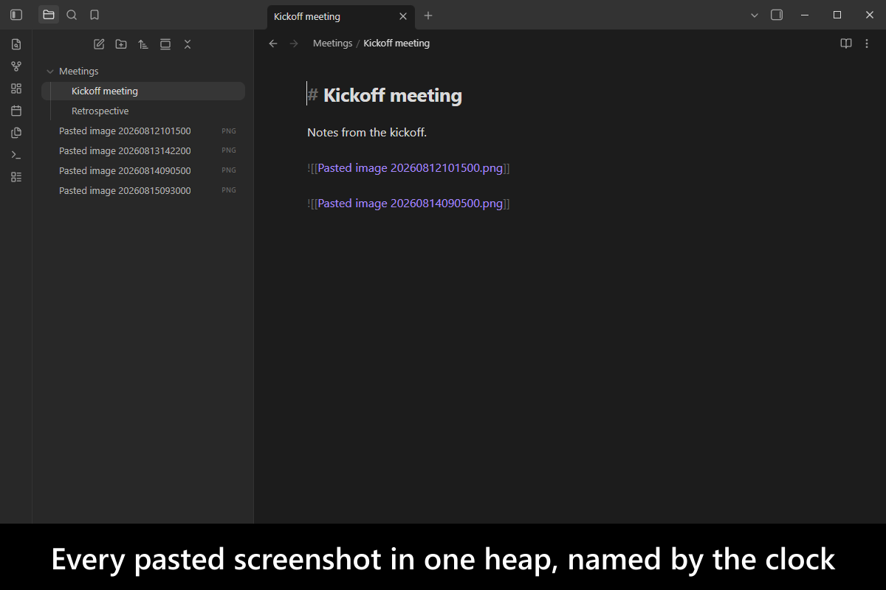
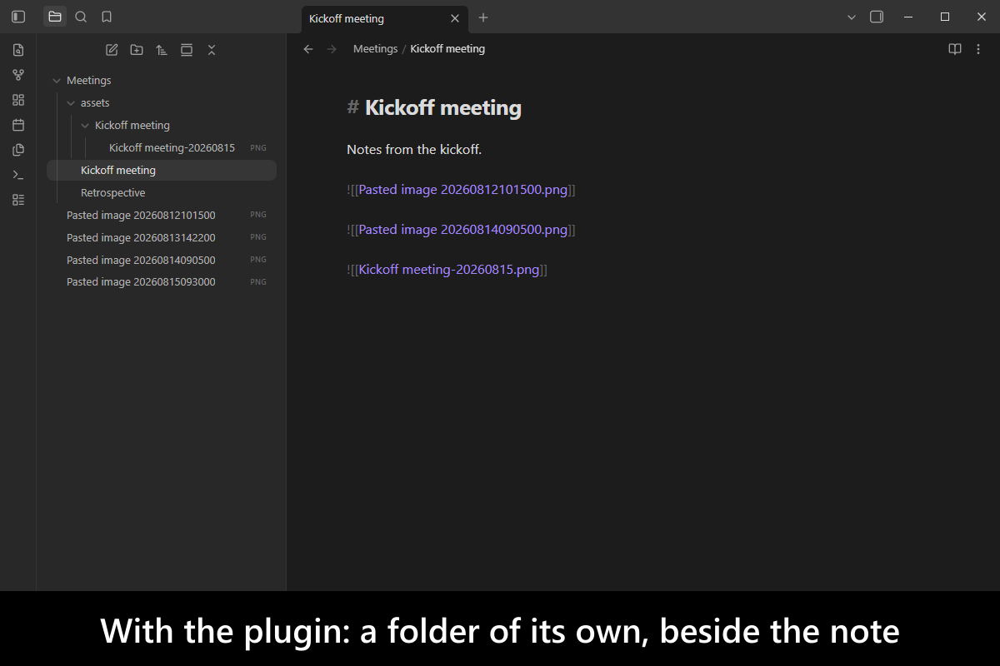
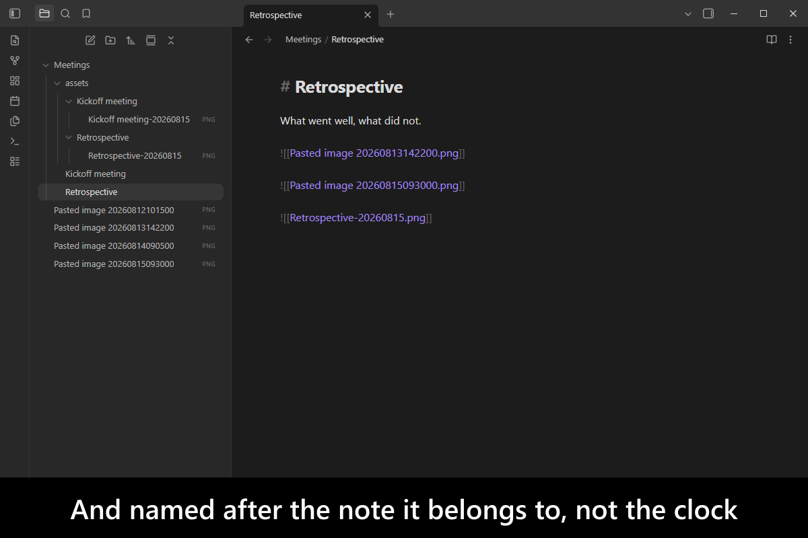
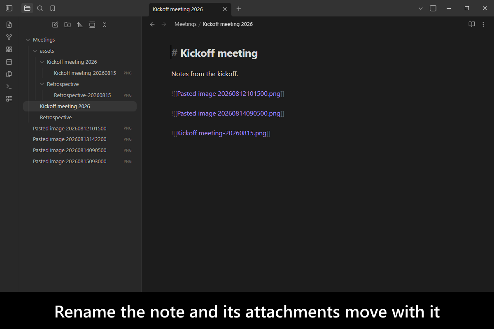
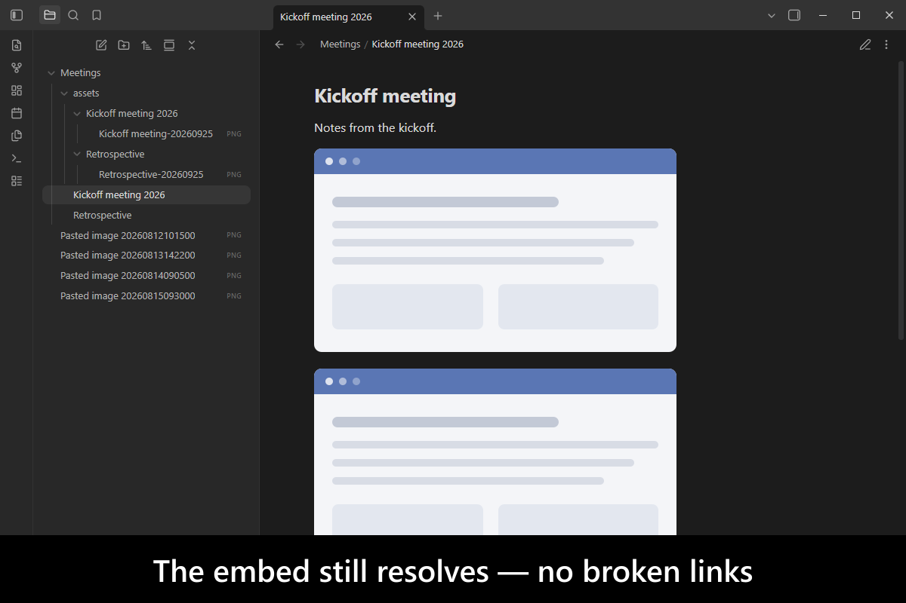
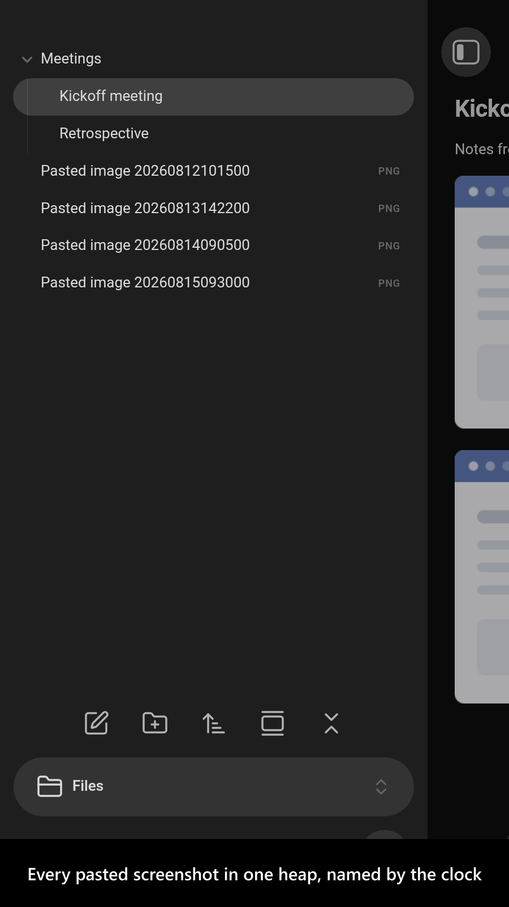
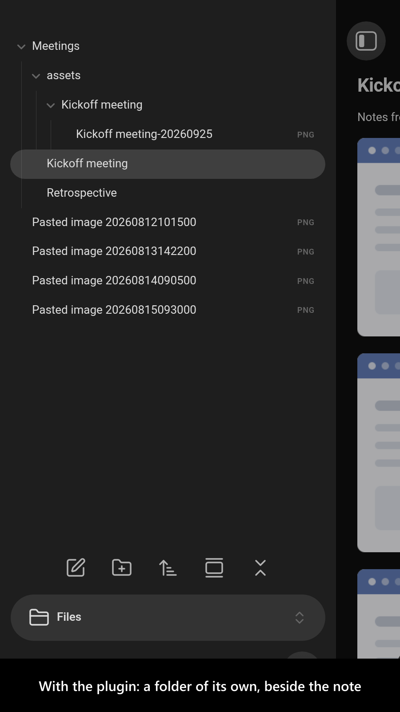
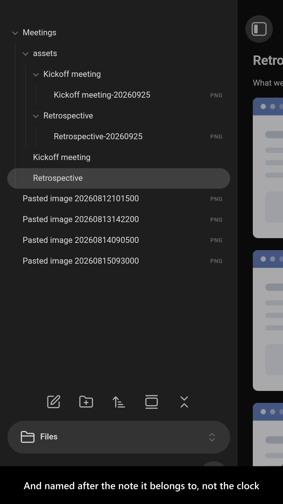
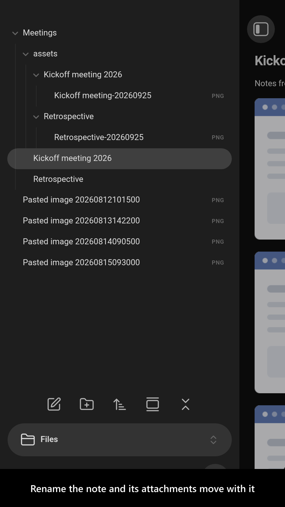
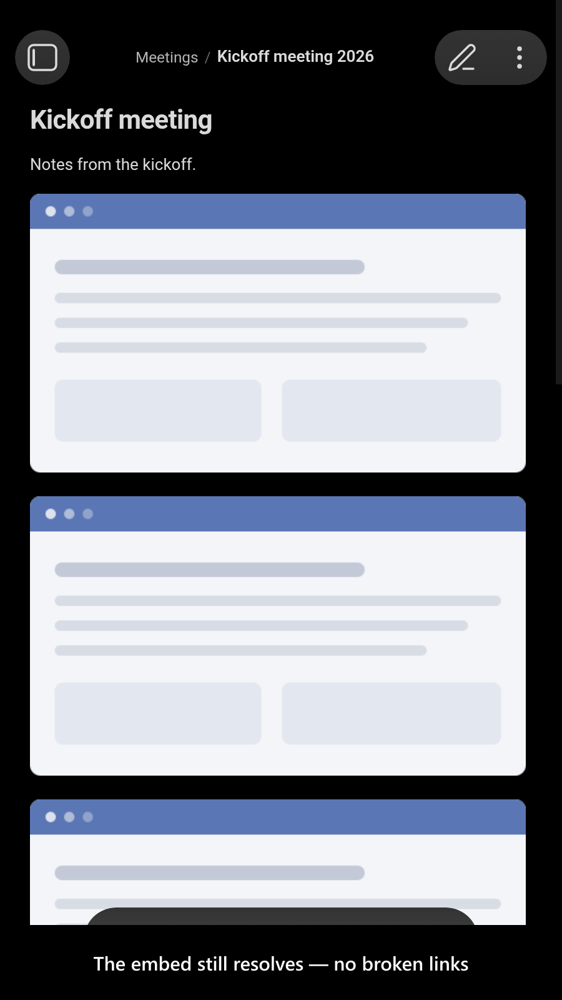

# Custom Attachment Location

[](https://www.buymeacoffee.com/mnaoumov) [](https://github.com/mnaoumov/obsidian-custom-attachment-location/releases) [](https://github.com/mnaoumov/obsidian-custom-attachment-location/releases) [](https://github.com/mnaoumov/obsidian-custom-attachment-location)

Paste a screenshot into [Obsidian](https://obsidian.md/) and it lands in one shared attachment folder under a name like `Pasted image 20250101120000`. A year later that folder holds a thousand files whose names say nothing about which note they belong to, and moving or renaming a note leaves its attachments behind. This plugin lets you decide **where** each attachment is stored and **what** it is called, from a pattern built out of tokens — `{{noteFileName}}`, `{{date:{momentJsFormat:'YYYYMMDD'}}}`, and about twenty more — and then keeps that arrangement true as notes are renamed, moved and deleted. The renaming and deleting half is handled by its companion plugin, [Advanced Rename and Delete Handler](https://obsidian.md/plugins?id=advanced-rename-and-delete-handler), which this plugin requires: it does nothing until that plugin is installed, and installs it for you in one click.

<!-- markdownlint-disable MD033 -->

<a href="https://github.com/mnaoumov/obsidian-custom-attachment-location/blob/HEAD/images/screenshots/screenshot-desktop-1.png"></a>

<details>
<summary>More screenshots</summary>

<div>
<a href="https://github.com/mnaoumov/obsidian-custom-attachment-location/blob/HEAD/images/screenshots/screenshot-desktop-2.png"></a>
<a href="https://github.com/mnaoumov/obsidian-custom-attachment-location/blob/HEAD/images/screenshots/screenshot-desktop-3.png"></a>
<a href="https://github.com/mnaoumov/obsidian-custom-attachment-location/blob/HEAD/images/screenshots/screenshot-desktop-4.png"></a>
<a href="https://github.com/mnaoumov/obsidian-custom-attachment-location/blob/HEAD/images/screenshots/screenshot-desktop-5.png"></a>
<a href="https://github.com/mnaoumov/obsidian-custom-attachment-location/blob/HEAD/images/screenshots/screenshot-mobile-1.png"></a>
<a href="https://github.com/mnaoumov/obsidian-custom-attachment-location/blob/HEAD/images/screenshots/screenshot-mobile-2.png"></a>
<a href="https://github.com/mnaoumov/obsidian-custom-attachment-location/blob/HEAD/images/screenshots/screenshot-mobile-3.png"></a>
<a href="https://github.com/mnaoumov/obsidian-custom-attachment-location/blob/HEAD/images/screenshots/screenshot-mobile-4.png"></a>
<a href="https://github.com/mnaoumov/obsidian-custom-attachment-location/blob/HEAD/images/screenshots/screenshot-mobile-5.png"></a>
</div>

</details>

<!-- markdownlint-enable MD033 -->

## Demo vault

**The documentation is a demo vault.** Every feature has a note that explains what it does and why you would want it, and walks you through it with a file you supply.

**[Start reading here](<./demo-vault/00 Start.md>)** — it is plain markdown, so it works on GitHub with nothing installed.

A copy of the vault ships with every release. You can access it via any of the following:

1. Running the **`Custom Attachment Location`: Open demo vault** command.
2. Downloading `obsidian-custom-attachment-location-demo-vault.zip` from the [Releases](https://github.com/mnaoumov/obsidian-custom-attachment-location/releases). It unzips into a single `obsidian-custom-attachment-location-demo-vault-<version>` folder.
3. Browsing its source in [`demo-vault/`](./demo-vault/README.md) in this repository.

## What it does

- **Choose the folder** each new attachment goes into, per note or per anything else a pattern can express — one folder beside every note, a folder per note, a folder per year. Or leave `shouldFollowObsidianAttachmentLocation` on, as a fresh install has it, and let Obsidian's own *Default location for new attachments* decide, keeping everything else this plugin does. Installing the plugin therefore moves nothing: attachments land where they always did until you switch that off and pick a pattern. While the plugin's pattern is in charge, Obsidian's own settings page says so instead of showing a value that is not in effect. [01 Attachment folder location](<./demo-vault/01 Attachment folder location.md>)
- **Choose the file name**, so an attachment is called something that says where it came from instead of `Pasted image 20250101120000`. With `attachmentRenameMode` on `Only pasted images`, as a fresh install has it, only pasted images are renamed: image data pasted from the clipboard, and image files pasted from it, which is how screenshot tools such as PixPin or the Windows Snipping Tool hand over a capture. An image file you drag in keeps its name. Turn on `shouldKeepNamesOfPastedNonScreenshotFiles` and an old image file you copy in a file manager and paste keeps its name too, while a pasted file still counts as a screenshot when it is under a minute old or `screenshotFilePaths` recognizes its path. [02 Attachment file naming](<./demo-vault/02 Attachment file naming.md>)
- **Patterns and tokens** — the vocabulary both of those are written in, including asking you for a value at paste time, reading one from the note's frontmatter, and defining your own tokens in JavaScript. [03 Tokens and patterns](<./demo-vault/03 Tokens and patterns.md>) · [04 Custom tokens](<./demo-vault/04 Custom tokens.md>) · [09 Token reference](<./demo-vault/09 Token reference.md>)
- **Catch attachments other plugins create** — some plugins write an attachment into the vault under a name of their own instead of asking Obsidian where it belongs. An image you paste into an `Excalidraw` drawing is one of them: `Excalidraw` handles that paste and writes the file itself, so it is covered by this setting and not by `attachmentRenameMode`. Set `renameAttachmentsCreatedByOtherPluginsMode` and those files are moved and renamed too, just after they appear — for every plugin, or only for the ones you name, or for every plugin except the ones you name. Off by default. [06 Settings](<./demo-vault/06 Settings.md>)
- **Collect attachments** — take the attachments a note already has and move them into the folder your settings say they belong in, for one note, one folder, or the whole vault. Turn on `shouldDeduplicateIdenticalAttachments` and an attachment whose destination already holds the same content is merged into that file instead of landing beside it as `image 1.png`. The files are compared by content, never by name. Off by default. A renaming pattern can build on the name an attachment **arrived with**, `{{originalAttachmentFileName}}`, which the plugin remembers through every rename, so `{{noteFileName}}-{{originalAttachmentFileName}}` gives `Note-img` and keeps it on the next collect instead of stacking `Note-Note-img`; `{{attachmentFileName}}` is the current name. **Show original attachment names**, **Prune original attachment names** and **Remember current name as original** let you see and correct what is remembered. [05 Collect attachments](<./demo-vault/05 Collect attachments.md>)
- **Delete unused attachments** — move an attachment no note references any more to the trash, after a confirmation dialog. A folder you have designated as one attachment is judged whole: it goes only when nothing outside it references anything inside it, and otherwise stays intact. Set `orphanAttachmentScanMode` and the whole-vault sweep also reaches attachment folders whose note has been deleted, which nothing leads to any more. Off by default. [08 Delete unused attachments](<./demo-vault/08 Delete unused attachments.md>)
- **Keep it true over time** — attachments follow their note when it is renamed or moved, and can be deleted with it. Since 12.0.0 that half is done by [Advanced Rename and Delete Handler](https://obsidian.md/plugins?id=advanced-rename-and-delete-handler), which this plugin requires — it loads nothing without it, explains why, and installs it in one click — and hands its old settings to. Installing it changes nothing on its own: its defaults do nothing until you turn renames or deletions on. Two plugins handling one rename corrupt links and move attachments twice, so exactly one owns it. [06 Settings](<./demo-vault/06 Settings.md>)
- **Link display text** — give an inserted attachment link the attachment's own name as its text, which plugins that render captions can then use. [07 Link display text](<./demo-vault/07 Link display text.md>)
- **Jump between a note and its attachments** — reveal the folder a note's attachments are saved into, and go from an attachment back to the note that owns it. [10 Navigation](<./demo-vault/10 Navigation.md>)

## Tokens

Moved to [09 Token reference](<./demo-vault/09 Token reference.md>) — every token, its format schema and worked examples. For what a pattern is and the tokens most people use, start at [03 Tokens and patterns](<./demo-vault/03 Tokens and patterns.md>).

This heading stays so that the **See available tokens** links inside the plugin's own settings tab keep resolving, including from versions already installed.

### Custom tokens

Moved to [04 Custom tokens](<./demo-vault/04 Custom tokens.md>).

### Markdown URL format

Moved to [06 Settings](<./demo-vault/06 Settings.md>), under `markdownUrlFormat`.

## For plugin developers

Everything this plugin offers another plugin is declared in one hand-written file — [api.d.ts](./api.d.ts) at the repository root. It imports from `obsidian` and nothing else, so you can copy it into your own code or reference it where it sits, with no build-time dependency on this repository.

The API is published through the `@mnaoumov/obsidian-lib` plugin registry under the plugin id `obsidian-custom-attachment-location`, so you get version negotiation, a handle that is revoked when this plugin unloads, and a wait that ends when it loads rather than a lookup that returns `undefined` because it ran first. The contract version is `1.3.0` and moves independently of the plugin's own version, so pin a range against the contract, not against a release.

Beside `api.d.ts`, [`api-contract.ts`](./api-contract.ts) holds the API's contract, `CUSTOM_ATTACHMENT_LOCATION_API_CONTRACT`: for every method, a schema over its arguments and a schema over what it returns. It is the constant this plugin publishes with the API, so copy it next to `api.d.ts` and pass it as the `contract`, and both sides check the same definition. Its schemas are [Standard Schema](https://standardschema.dev) objects built with [`@mnaoumov/typescript-lib/api-contract`](https://www.npmjs.com/package/@mnaoumov/typescript-lib), which carries the generic half (the contract types, the schema builders and the guard builders), and its file guards come from [`@mnaoumov/obsidian-lib`](https://www.npmjs.com/package/@mnaoumov/obsidian-lib), so copying it means adding both packages (`npm install @mnaoumov/typescript-lib @mnaoumov/obsidian-lib`, typescript-lib `1.3.0` or later). Apart from those two, the file imports only `obsidian` and `./api.d.ts`. (It is not named `api.ts`: TypeScript would read `api.d.ts` as that file's own declarations.)

If your plugin already uses [`@mnaoumov/obsidian-lib`](https://mnaoumov.dev/obsidian-lib/guides/cross-plugin-apis/), `watchPluginApi` is the whole of it:

```ts
const apiRef = watchPluginApi<CustomAttachmentLocationApi>({
  apiVersionRange: '^1',
  app,
  component: this,
  contract: CUSTOM_ATTACHMENT_LOCATION_API_CONTRACT,
  pluginId: 'obsidian-custom-attachment-location'
});

const folder = await apiRef.value?.getAttachmentFolderPath({ notePath: 'Notes/Alpha.md' });
const properPath = await apiRef.value?.getProperAttachmentPath({ attachmentPathOrFile: 'image.png', notePath: 'Notes/Alpha.md' });
```

If your plugin does not use `@mnaoumov/obsidian-lib` — and is not going to — you still need no dependency on anything. The registry, and the two events a plugin announces itself through, are a documented wire protocol reachable with the `obsidian` module alone; [Plugin API protocol](https://mnaoumov.dev/obsidian-lib/guides/plugin-api-protocol/) is that route written out, and `api.d.ts` types it just as well, since nothing in that file imports the library either. Only the contract takes packages, and the raw route works without it. Look the API up each time you use it rather than keeping it in a field: the raw object does not know when this plugin has unloaded.

### Do not read `vault.getConfig('attachmentFolderPath')`

This plugin patches that call, which makes it look like the seam you want. It is not one. The patch answers with this plugin's value only while a note is open, and the value it answers with is **the open note's** — computed once when the file was opened. A plugin looping over every note in the vault therefore gets the active note's attachment folder for all of them, silently, with no error and nothing to distinguish it from a correct answer. The patch is a write-path override for Obsidian's own attachment creation, not a readable configuration.

`getAttachmentFolderPath` is the read, asked once per note. It answers `null` when this plugin leaves that note alone entirely, which is your cue to fall back to Obsidian's own `attachmentFolderPath` — a different answer from this plugin not being installed, and deliberately so.

Both reads arrived in contract version `1.0.0`, and both are asynchronous: an attachment folder is the result of evaluating a user-written template whose tokens can read the note's frontmatter and the attachment's bytes, so there is no synchronous answer to hand back. Neither ever asks the user anything, so a whole-vault audit raises no dialogs.

### Collecting a note's attachments

`collectAttachments`, added in contract version `1.2.0` (ask for `'^1.2.0'`), collects the attachments of the notes and folders you name, the way the `Collect attachments` commands do, without opening the note first:

```ts
await apiRef.value?.collectAttachments({ pathsOrFiles: ['Notes/Alpha.md'] });
```

It is an action, not a read, so it asks what the command asks: it confirms several files or a folder with the user, and it follows the user's settings for an attachment several notes share. The promise settles once the collect has finished, queued behind any collect already running. It replaces reaching into the plugin instance for `collectAttachmentsInAbstractFiles`, which still works but is superseded.

### Moving attachments the way this plugin would

Two members added in contract version `1.3.0` (ask for `'^1.3.0'`) serve a plugin that moves or deletes attachments on a note's behalf and wants to follow this plugin's policy:

```ts
const attachmentPath = await apiRef.value?.getAvailablePathForAttachments({
  attachmentFileBaseName: 'image',
  attachmentFileExtension: 'png',
  context: 'RenameNote',
  notePathOrFile: 'Notes/Renamed.md',
  oldAttachmentPathOrFile: 'Attachments/Alpha/image.png',
  oldNotePathOrFile: 'Notes/Alpha.md',
  readAttachmentFileContent: null,
  shouldSkipMissingAttachmentFolderCreation: true
});

const isUnitFolder = apiRef.value?.isAttachmentUnitFolder({ folderPath: 'Notes/page_files' });
```

`getAvailablePathForAttachments` is this plugin's full resolver, with the options `Vault.getAvailablePathForAttachments` cannot express: the note's old path during a rename, the attachment's bytes for a template that hashes them, and whether to keep the file name or skip the duplicate check. Its params are the same fields as `@mnaoumov/obsidian-lib`'s `GetAvailablePathForAttachmentsExtendedFunctionParams`. It acts for the caller, so a `{{prompt}}` token may ask the user. `isAttachmentUnitFolder` says whether the user designated a folder whose whole hierarchy travels as one attachment, and is synchronous.

Both replace the `extended` and `checkIsAttachmentUnitFolder` members this plugin used to graft onto `app.vault.getAvailablePathForAttachments`. Those were removed in 15.0.0.

### Handing collect settings over

A plugin that used to collect attachments itself hands its settings over through `migrateSettings`, added in contract version `1.1.0`, so ask for `'^1.1.0'`. It proposes the values it held, and this plugin shows the user each one that would change next to the value it holds now. Nothing is written unless the user approves, and `isApplied: false` means they cancelled, so keep the proposal pending. `api.d.ts` lists the settings that can be proposed. The shape matches `@mnaoumov/obsidian-lib`'s `SettingsMigrationApi`, so its `SettingsMigrationComponent` can run the whole offer:

```ts
this.addChild(new SettingsMigrationComponent<MigratableCollectSettings>({
  apiVersionRange: '^1.1.0',
  app,
  getProposedSettings: () => settingsComponent.settings.proposedCollectSettings,
  pluginSettingsComponent: settingsComponent,
  providerPluginId: 'obsidian-custom-attachment-location',
  retireProposedSettings: () => settingsComponent.editAndSave((settings) => {
    settings.proposedCollectSettings = null;
  }),
  sourcePluginId: this.manifest.id
}));
```

## Installation

The plugin is available in [the official Community Plugins repository](https://community.obsidian.md/plugins/obsidian-custom-attachment-location).

### Beta versions

To install the latest beta release of this plugin (regardless if it is available in [the official Community Plugins repository](https://community.obsidian.md) or not), follow these steps:

1. Ensure you have the [BRAT plugin](https://community.obsidian.md/plugins/obsidian42-brat) installed and enabled.
2. Click [Install via BRAT](https://intradeus.github.io/http-protocol-redirector?r=obsidian://brat?plugin=https://github.com/mnaoumov/obsidian-custom-attachment-location).
3. An Obsidian pop-up window should appear. In the window, click the `Add plugin` button once and wait a few seconds for the plugin to install.

## Debugging

By default, debug messages for this plugin (id: `obsidian-custom-attachment-location`) are hidden.

If you need to enable them refer to the [documentation](https://mnaoumov.dev/obsidian-lib/guides/debugging/).

## Attributions

[In Oct 2021](https://github.com/RainCat1998/obsidian-custom-attachment-location/commit/1c92b85f7a5eba71cf54e20452eb8f3c2404a273), the plugin was created by [RainCat1998](https://github.com/RainCat1998).

[From July 2024](https://github.com/RainCat1998/obsidian-custom-attachment-location/issues/59), the plugin is maintained by [Michael Naumov](https://github.com/mnaoumov/).

From December 2025, the project repository is hosted at [mnaoumov/obsidian-custom-attachment-location](https://github.com/mnaoumov/obsidian-custom-attachment-location).

The original author's repository is preserved as an archive of issues/PRs/discussions/releases at [RainCat1998/obsidian-custom-attachment-location](https://github.com/RainCat1998/obsidian-custom-attachment-location).

## Changelog

All notable changes to this project will be documented in the [CHANGELOG](./CHANGELOG.md).

## Contributing

Contributions are welcome — see [CONTRIBUTING](./CONTRIBUTING.md) to get set up.

## Support

<!-- markdownlint-disable MD033 -->

<a href="https://www.buymeacoffee.com/mnaoumov" target="_blank"></a>

<!-- markdownlint-enable MD033 -->

## My other Obsidian resources

[See my other Obsidian resources](https://github.com/mnaoumov/obsidian-resources).

## License

Copyright (c) [RainCat1998](https://github.com/RainCat1998), [Michael Naumov](https://github.com/mnaoumov/).
